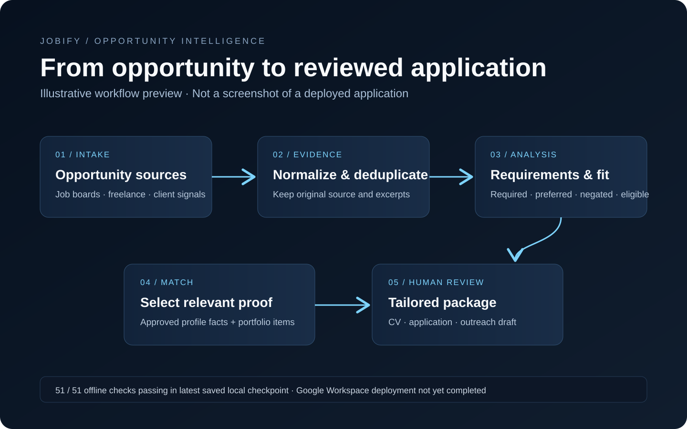

# Jobify
### Opportunity discovery and application support

Jobify is a personal opportunity-intelligence and application-support system built primarily with Google Apps Script and Google Sheets.

It is intended to organize relevant jobs, freelance and agency opportunities, and potential-client signals; assess eligibility and fit against an evidence-backed professional profile; select relevant portfolio proof; and prepare application or outreach packages for review.

**Status:** Active local build. The latest saved project checkpoint reports **51/51 offline tests passing** and a successful Apps Script bundle build. Jobify is **not yet deployed to Google Workspace**; live Google and external-source integrations must be verified separately.

## What Jobify is designed to do

- Normalize opportunities from registered sources.
- Deduplicate repeated listings and retain source evidence.
- Extract requirements with supporting excerpts.
- Distinguish required, preferred and negated criteria.
- Assess eligibility and skills fit with explainable reasons.
- Match approved profile facts and relevant portfolio evidence.
- Prepare tailored CV, application and outreach packages.
- Route uncertain or unsupported claims to human review.
- Keep external actions behind explicit review and policy safeguards.

## Architecture

See [docs/architecture.md](docs/architecture.md) for the workflow diagram.

## Test and build evidence

The latest saved local checkpoint reports **51/51 offline checks passing** across the core classification, eligibility, fit, deduplication and package logic, alongside a successful Apps Script bundle build and Builder preflight.

These are offline tests. They do not prove that the external-source readers, Google Sheets/Docs/Gmail integrations, scheduled processing or outbound actions are deployed and operating in production.

## Workflow preview

A genuine product screenshot was not present in the connected Jobify project materials, so this visual is explicitly an illustration rather than a fabricated app capture.

## Technology

Google Apps Script · Google Sheets · JavaScript · clasp development workflow · Data normalization and deduplication · Deterministic requirement classification and fit assessment · Offline workflow tests

## Safety and operating boundaries

- Profile facts and portfolio claims should be approved and evidence-backed.
- Missing evidence for an explicitly required skill should not be assumed.
- Scheduled discovery should be tested with email and portal actions disabled.
- Email applications and client outreach remain subject to review and explicit action policy.
- Universal portal submission is not supported.
- Secrets, private account facts, job application records and personal documents do not belong in this public documentation repository.

[John Adewole's portfolio](https://jaytee-automation-engineer.vercel.app/)
