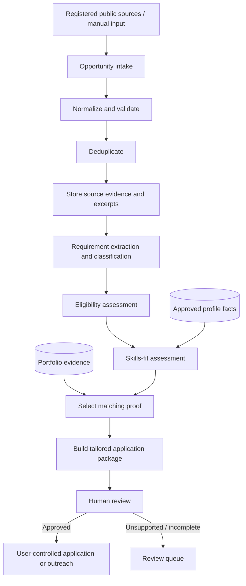

# Jobify architecture

## Important boundaries

- Requirement, eligibility and fit results should retain the evidence used to reach them.
- Negated requirements must not be incorrectly treated as must-have criteria.
- Missing evidence for explicitly required skills routes to review rather than being inferred.
- A generated package is a draft for human review, not an automatically submitted application.
- Live source and Google Workspace integration status is separate from offline test results.
